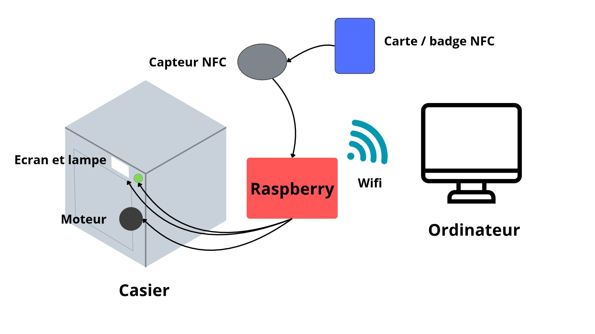
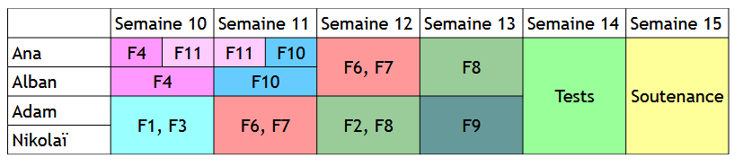

---
title: Analyse fonctionnelle projet MI7 Groupe B
date: 2026-11-19
subtitle: UL1IN021
author: Ana DESMARS, Adam LATROUS, Alban SEGRETAIN, Nikolaï SCHLEICHER
---

# Casier connécté

Notre produit est un casier connécté qui est reservable en ligne par les étudiants ou utilisateurs.
Le but de notre projet est de fournir un système de casier intelligent, potentiellement à placer dans les bibliothèques ou les restaurants universitaires, pour que les élèves puissent poser leurs affaires si besoin.

## Schéma général du projet

Le dispositif sera composé de :
* Raspberry PI
* Capteur NFC (en plus de cartes compatibles)
* Moteur
* Ecran
* LED Rouge
* LED Verte

 
## Scénarios d'usages

<u>Scénario 1:</u>
Un utilisateur passe sa carte sur le capteur NFC alors que le casier est réservé par un autre utilisateur. Le casier reste fermé et la led devient rouge et l'écran affiche un message d'erreur avec le temps jusqu'au quel le casier a été réservé.

<u>Scénario 2:</u>
Un utilisateur se connecte sur le site et réserve un créneau pour le casier. Lorsqu'il passe sa carte sur le capteur, le casier s'ouvre pour le laisser poser ses affaires et se referme lorsqu'il la repasse.

<u>Scénario 3:</u>
Un utilisateur se connecte sur le site pour annuler son créneau car il n'aura finalement pas besoin du casier.

<u>Scénario 4:</u>
L'administrateur se connecte avec un compte admin pour regarder les informations du casier et/ou des réservations et supprimer des créneaux si nécessaire.

## Description des fonctionnalités

| Numéro | Nom | Description | Sur quoi la fonction agit | Importance |
|--------|-----|-------------|---------------------------|------------|
| **1**   | **Lecture donnée** | Le raspberry lit les données du capteur NFC | Capteur, Raspberry, base de données | **1** |
|  2  | Affichage LED/Ecran | Le raspberry envoie les commandes pour allumer la LED correspondante (verte ou rouge) et afficher un message à l'écran après le passage d'une carte sur le capteur selon si le casier est réservé ou non | Capteur, raspberry, base de données | 3 |
|  **3**  | **Ouvrir / fermer la porte** | Créer le mécanisme qui permet d'ouvrir / fermer le casier à l'aide du moteur lorsque le raspberry envoie la commande. | Capteur, raspberry, base de données | **1** |
|  **4**  | **Réserver un créneau** | Permet à l'utilisateur de réserver le casier sur le site web | Site, base de données | **1** |
|  5  | Annuler son créneau | Permet à l'utilisateur d'annuler une réservation qu'il a fait au préalable | Site, base de données | 4 |
|  6  | Créer un compte | L'utilisateur crée un compte en son nom | Site, base de données | 2 |
|  7  | Se logguer | L'utilisateur entre son login et mot de passe | Site, base de données | 2 |
|  8  | Voir / modifier la base de données | L'administrateur a accès à la base de donnée et peut annuler un créneau s'il le souhaite | Site, base données | 3 |
|  9  | Limiter le nombre de réservations | Le site web empêche au même utilisateur de réserver trop de créneaux d'affilée pour laisser de la place aux autres | Site, base de données | 4 |
|  10  | Voir ses réservations | L'utilisatreur a accès à une liste de ses prochaines réservations et de son historique de réservations | Site, base de données | 2 |
|  11  | Ranger ses affaires | L'utilisateur range ses affaires dans le casier | Boîte | 2 |

## Planning prévisionnel

