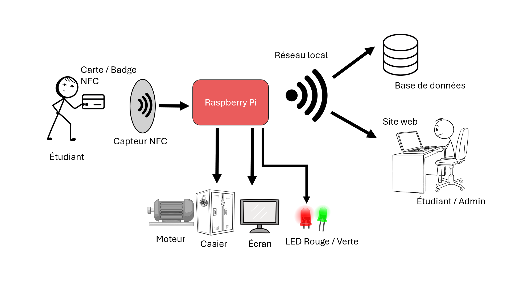

**Casier connecté** 

**Introduction** 

Notre produit est un casier connecté qui est réservable en ligne par les étudiants ou utilisateurs. Le but de notre projet est de fournir un système de casier intelligent, potentiellement à placer dans les bibliothèques ou les restaurants universitaires, pour que les élèves puissent poser leurs affaires si besoin. 

**Schéma général du projet** 

Le dispositif sera composé de : 

* Raspberry Pi  
* Capteur NFC (en plus de cartes compatibles)   
* Moteur   
* Ecran   
* LED Rouge   
* LED Verte 

Figure 1\. Schéma général du projet

La figure 1 présente le dispositif du casier connecté. Le système repose sur un Raspberry Pi relié à un capteur NFC, à un moteur actionnant l’ouverture et la fermeture de la porte du casier, à un écran et à des LED rouge et verte pour indiquer l’état d’accès. Les données de réservation, d'utilisateurs et d'accès sont enregistrées et consultées dans une base de données, tandis qu'un site web permet aux étudiants de réserver ou d'annuler un créneau et à l'administrateur de consulter ou supprimer des réservations. L'humain intervient à la fois via le site web (pour la gestion des comptes et des créneaux) et physiquement auprès du casier en passant sa carte ou son badge NFC devant le capteur. 

**Scénarios d'usages** 

Scénario 1: Un utilisateur passe sa carte sur le capteur NFC alors que le casier est réservé par un autre utilisateur. La carte Raspberry Pi vérifie auprès de la base de données si l’utilisateur possède une réservation. Puisque ce n’est pas le cas, le casier reste fermé et la LED devient rouge et l'écran affiche un message d'erreur avec le temps jusqu'à quelle heure le casier a été réservé.

Scénario 2: Un utilisateur se connecte sur le site et réserve un créneau pour le casier. La réservation est alors enregistrée dans la Base de données. Lorsqu'il passe sa carte sur le capteur, la carte Raspberry Pi vérifie auprès de la base de données si l’utilisateur possède une réservation. Puisque c’est le cas, la carte Raspberry Pi allume la LED verte, affiche un message sur l’écran et le casier s'ouvre pour le laisser poser ses affaires et se referme lorsqu'il repasse sa carte sur le lecteur. 

Scénario 3: Un utilisateur se connecte sur le site pour annuler son créneau car il n'aura finalement pas besoin du casier. La réservation est alors supprimée de la base de données.

Scénario 4: L'administrateur se connecte avec un compte admin pour regarder les informations du casier et/ou des réservations et supprimer des créneaux si nécessaire. Le site web récupère alors les informations nécessaires depuis la base de données, et les met à jour s’il le faut. 

**Description des fonctionnalités**

| n°  | Nom  | Description  | Sur quoi la  fonction agit | Importance |
| ----- | ----- | ----- | ----- | ----- |
| **1**  | **Lecture  donnée** | Le Raspberry Pi lit les données issues du capteur NFC lorsqu’un badge ou une carte est approché. | Capteur NFC,  Raspberry,  base de  données | **1** |
| 2  | Signaler l’état du casier | Le Raspberry Pi envoie les commandes pour allumer la LED correspondante (verte ou rouge) et afficher un message à l'écran après le passage d'une carte sur le capteur selon si le casier est réservé ou non | Raspberry Pi,  LED, écran  base de  données, utilisateur | 3 |
| **3**  | **Ouvrir /  fermer la  porte** | Le Raspberry Pi envoie une commande au moteur pour ouvrir / fermer la porte du casier. | Moteur,  Raspberry Pi, porte du casier,  base de  données | **1** |
| **4**  | **Réserver un créneau** | Le site web permet à l'utilisateur de réserver le casier sur un créneau disponible et enregistre la réservation dans la base de données. | Site, base de  données, utilisateur | **1** |
| 5  | Annuler une réservation | Permet à l'utilisateur d'annuler une  réservation qu'il a faite au préalable | Site, base de  Données, utilisateur | 3 |
| 6  | Enregistrer un compte utilisateur | Le site web permet à l’utilisateur de créer un compte à son nom et enregistre ses identifiants dans la base de données | Site, base de  données, utilisateur | 2 |
| 7  | Authentifier l’utilisateur | Le système vérifie l’identifiant et le mot de passe saisis sur le site web par rapport à la base de données utilisateurs et ouvre la session. | Site, base de  données, utilisateur, utilisateurs | 2 |
| 8  | Afficher et modifier les données de réservations | Le site web affiche à l'administrateur les informations du casier et des réservations issues de la base de données, et lui permet d’annuler ou supprimer un créneau. | Site, base données, administrateur | 3 |
| 9  | Limiter le  nombre de  réservations | Le site web empêche au même utilisateur de réserver trop de créneaux d'affilée pour laisser de la place aux autres | Site, base de  données, utilisateur | 4 |
| 10  | Afficher les réservations | Le site web affiche à l’utilisateur la liste de ses prochaines réservations ainsi que son historique de réservations. | Site, base de  données, utilisateur | 2 |
| 11  | Stocker les  affaires | Le casier met à disposition un espace fermé et sécurisé permettant à l’utilisateur de déposer ses affaires personnelles | Casier, utilisateur | 2 |

**Planning prévisionnel**

|  | Semaine 10 |  | Semaine 11 |  | Semaine 12 |  | Semaine 13 |  | Semaine 14 | Semaine 15 |
| :---- | ----- | :---: | ----- | :---: | ----- | :---: | ----- | :---: | ----- | ----- |
| **Ana** | **F4**  | **F11** | **F11** | **F10** | **F6** | **F7** | **F8** |  | **Test** | **Soutenance** |
| **Alban** | **F4** |  | **F10** |  | **F6** | **F7** | **F8** |  | **Test** | **Soutenance** |
| **Adam** | **F1** | **F3**  | **F6** | **F7** | **F2** | **F8** | **F5** | **F9** | **Test** | **Soutenance** |
|  |  | **F2** |  |  |  |  |  |  |  |  |
| **Nikolaï** | **F1** | **F3** | **F6** | **F7** | **F2** | **F8** | **F5** | **F9** | **Test** | **Soutenance** |
|  |  | **F2** |  |  |  |  |  |  |  |  |

Figure 2\. Planning prévisionnel du projet.

Le planning prévisionnel, est comme son nom l’indique prévisionnel. Il peut changer au cours du temps pour s’adapter au besoin du projet. Nous n’estimons pas prendre de vacances.
